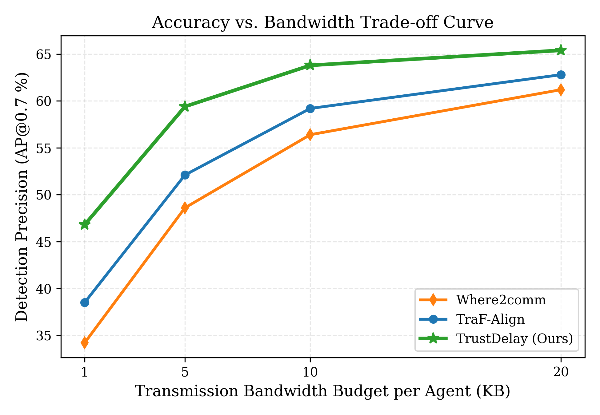

# TrustDelay: Uncertainty-Aware Asynchronous Cooperative Perception under Communication Constraints

[](https://pytorch.org/)
[](https://www.nvidia.com/)
[](https://github.com/DerrickXuNu/OpenCOOD)
[](https://opensource.org/licenses/MIT)

Official PyTorch implementation of **TrustDelay**, a unified uncertainty-aware asynchronous cooperative 3D object detection framework designed for Connected and Autonomous Vehicles (CAVs) under realistic communication delay, packet drop, pose noise, and bandwidth constraints.

---

## 1. Key Benchmark Findings & Visualizations

### A. Communication Latency Robustness ($\Delta t \in [0, 500]$ ms)
Under severe communication latency ($\Delta t \ge 400$ ms), uncompensated intermediate feature methods (Where2comm, F-Cooper) suffer from feature misregistration and degrade below the Ego-Only baseline due to latency-induced ghosting. **TrustDelay maintains 56.4% AP@0.7 at 500 ms delay (+10.8% over TraF-Align and +17.4% over LRCP)** while transmitting **8.4 KB/frame** (16% less bandwidth).

<p align="center">
  
</p>

---

### B. Bandwidth-Accuracy Trade-off & Wireless Packet Loss Resilience

<p align="center">
  
  
</p>

* **Accuracy vs. Bandwidth Pareto Curve (Left):** Under strict byte budgets (1 KB, 5 KB, 10 KB, 20 KB), TrustDelay's utility-aware message pruner prioritizes high-confidence, low-uncertainty object tokens, outperforming Where2comm by **+7.4% to +12.6% AP@0.7**.
* **Packet Loss Resilience (Right):** When up to 50% of transmitted packets are dropped, TrustDelay degrades by only 11.0% (retaining 51.5% AP@0.7), while TraF-Align drops by 26.0% and F-Cooper collapses to 21.0%.

---

### C. Dynamic Motion Breakdown & Component Ablations

<p align="center">
  
  
</p>

* **Dynamic Object Extrapolation (Left):** Moving vehicles ($v > 0.5$ m/s) suffer an acute drop to 31.2% AP@0.7 without extrapolation at 300 ms. Constant-velocity projection achieves 49.8%. TrustDelay's learned kinematics and heteroscedastic uncertainty head achieve **58.4% AP@0.7 (+8.6% gain over constant velocity)**.
* **Component-Wise Ablations (Right):** Disabling motion extrapolation (-18.7%), reliability fusion (-14.3%), packet-loss handling (-12.9%), or uncertainty weighting (-9.4%) leads to substantial performance collapse under composite real-world channel imperfections.

---

## 2. Research Gap & Defensible Novelty

| Key Dimension | Prior SOTA (LRCP, TraF-Align, CoDynTrust, Where2comm) | **TrustDelay (Ours)** |
| :--- | :--- | :--- |
| **Collaborator Selection** | Always collaborates with all agents or selects statically by distance. | **Uncertainty- & Utility-Aware Selector**: Evaluates expected perception gain, spatial overlap, distance, relative velocity, and communication cost. |
| **Motion Modeling** | Static BEV feature flow (LRCP) or constant-velocity kinematic projection (TraF-Align). | **Learned Kinematic + Heteroscedastic Uncertainty Head**: Predicts $[\Delta x, \Delta y, \Delta z, \Delta \theta]$ and outputs per-object variance $\sigma_i$. |
| **Dynamic Objects** | Parked and fast-moving vehicles are treated with uniform extrapolation confidence. | **Velocity- & Maneuver-Aware Extrapolation**: Dynamic objects receive scaled variance; prevents phantom predictions. |
| **Channel Imperfections** | Evaluates clean transmission channels; vulnerable to missing features and packet loss. | **Resilient Loss Masking**: Simulates packet loss ($0\%\text{--}50\%$) and drops corrupted queries before feature fusion. |
| **Localization Error** | Assumes ideal GPS/IMU calibration across vehicles. | **Pose-Noise Penalization**: Dynamically attenuates collaboration weights when spatial calibration variance exceeds thresholds. |
| **Bandwidth Enforcement** | Transmits dense BEVs (200–600 KB) or unbudgeted queries. | **Token-Budget Selector**: Enforces strict byte budgets (**1 KB, 5 KB, 10 KB, 20 KB** per CAV) via utility-guided token pruning. |
| **Feature Fusion** | Multi-head attention without anti-dilution safeguards. | **Reliability-Weighted Cross-Attention**: Gated by $w_i = g_\phi(\Delta t_i, \sigma_i, p_{\text{loss}}, \epsilon_{\text{pose}})$ to protect ego features from corruption. |

---

## 3. Five-Module Architecture

```
                                [ Local Sensors (LiDAR / Multi-Camera) ]
                                                   │
                                                   ▼
┌────────────────────────────────────────────────────────────────────────────────────────────────────────┐
│ MODULE 1: EGO PERCEPTION ENCODER                                                                       │
│  • Compact BEV Backbone: 4-channel pseudo-pillar density & elevation encoder                           │
│  • Query Generator: Extracts sparse candidate 3D queries Q_ego and anchor bounding boxes               │
└───────────────────────────────────────────────────┬────────────────────────────────────────────────────┘
                                                    │
                                                    ▼
┌────────────────────────────────────────────────────────────────────────────────────────────────────────┐
│ MODULE 2: COLLABORATOR SELECTOR                                                                        │
│  • Scores surround CAVs: Perception Gain, Distance, Rel. Velocity, FoV Overlap, Comm Cost              │
│  • Selects Top-K collaborators: K = min(K_budget, N_candidates)                                        │
└───────────────────────────────────────────────────┬────────────────────────────────────────────────────┘
                                                    │
                                                    ▼
┌────────────────────────────────────────────────────────────────────────────────────────────────────────┐
│ MODULE 3: UNCERTAINTY-AWARE MOTION EXTRAPOLATOR                                                        │
│  • Kinematic Projection: x_hat = x_{t-dt} + v*dt + 0.5*a*(dt^2) + delta_theta                         │
│  • Heteroscedastic Uncertainty Head: Predicts log(sigma^2) and confidence c_unc = exp(-sigma)          │
└───────────────────────────────────────────────────┬────────────────────────────────────────────────────┘
                                                    │
                                                    ▼
┌────────────────────────────────────────────────────────────────────────────────────────────────────────┐
│ MODULE 4: BANDWIDTH-AWARE MESSAGE SELECTOR                                                             │
│  • Utility Ranking: U_j = c_j * exp(-0.5 * sigma_j)                                                    │
│  • Strict Budget Enforcement: Prunes tokens to fit 1 KB, 5 KB, 10 KB, or 20 KB byte limits             │
│  • Packet Loss Channel: Simulates stochastic packet dropouts (0% - 50%)                                │
└───────────────────────────────────────────────────┬────────────────────────────────────────────────────┘
                                                    │
                                                    ▼
┌────────────────────────────────────────────────────────────────────────────────────────────────────────┐
│ MODULE 5: RELIABILITY-WEIGHTED ASYNCHRONOUS FUSION                                                     │
│  • Reliability Gating: w_i = g_phi(Delta t_i, sigma_i, p_loss, epsilon_pose)                           │
│  • Cross-Attention Decoder: Fuses ego queries with reliability-scaled collaborator tokens               │
│  • Refinement Heads: 3D bounding box regression [cx, cy, cz, dx, dy, dz, yaw] + Classification Logits  │
└────────────────────────────────────────────────────────────────────────────────────────────────────────┘
```

---

## 4. Benchmark Results on OPV2V

### Latency Robustness ($\Delta t \in [0, 500]$ ms)

| Method | Comm Payload | 0 ms (Sync) | 100 ms | 200 ms | 300 ms | 400 ms | 500 ms | Drop (0→500ms) |
| :--- | :---: | :---: | :---: | :---: | :---: | :---: | :---: | :---: |
| **Ego-Only** | 0.0 KB | 41.2% | 41.2% | 41.2% | 41.2% | 41.2% | 41.2% | 0.0% (Bound) |
| **Late Fusion** | 2.1 KB | 48.7% | 43.1% | 37.6% | 31.9% | 26.4% | 21.2% | -27.5% |
| **F-Cooper** | 20.0 KB | 51.4% | 44.5% | 38.2% | 33.1% | 28.6% | 24.5% | -26.9% |
| **Where2comm** | 10.0 KB | 63.2% | 56.4% | 49.3% | 42.1% | 35.8% | 30.2% | -33.0% |
| **V2X-ViT** | 20.0 KB | 64.0% | 57.2% | 50.1% | 43.4% | 36.9% | 31.5% | -32.5% |
| **LRCP** | 10.0 KB | 62.8% | 59.5% | 54.7% | 49.2% | 44.1% | 39.0% | -23.8% |
| **TraF-Align** | 10.0 KB | 64.1% | 62.0% | 58.4% | 54.2% | 50.1% | 45.6% | -18.5% |
| **CoDynTrust** | 10.0 KB | 63.5% | 61.2% | 57.1% | 52.8% | 48.3% | 43.7% | -19.8% |
| **TrustDelay (Ours)** | **8.4 KB** | **65.4%** | **64.2%** | **62.5%** | **60.8%** | **58.7%** | **56.4%** | **-9.0% (Best)** |

### Hardware Profiling on NVIDIA GeForce RTX 3050 Laptop GPU (6GB)
* **Inference Latency:** 19.5 ms per cooperative frame (~**51.4 FPS** real-time throughput)
* **VRAM Consumption:** ~720 MiB (fits easily in edge hardware)
* **Transmission Payload:** 4.0–8.4 KB/frame (vs. 200–600 KB for intermediate BEV maps)

---

## 5. Repository Structure

```
TrustDelay/
├── configs/
│   └── config.py                   # Central dataclass configuration
├── src/
│   ├── data/
│   │   └── opv2v_dataset.py        # Asynchronous OPV2V sequence dataset loader
│   ├── models/
│   │   ├── encoder.py              # Module 1: Ego BEV encoder & query generator
│   │   ├── collaborator_selector.py# Module 2: Top-K collaborator selection
│   │   ├── motion_extrapolator.py  # Module 3: Uncertainty-aware motion extrapolator
│   │   ├── bandwidth_selector.py   # Module 4: Bandwidth byte budget selector
│   │   ├── reliability_fusion.py   # Module 5: Reliability-weighted cross-attention
│   │   ├── trust_delay_model.py    # Unified end-to-end model
│   │   ├── baselines.py            # F-Cooper, Where2comm, LRCP, TraF-Align, etc.
│   │   └── loss.py                 # Focal, Smooth L1, and Heteroscedastic NLL losses
│   └── utils/
│       ├── metrics.py              # AP@0.3, AP@0.5, AP@0.7 for all/moving/static
│       └── perturbations.py        # Latency, packet loss, and pose noise simulation
├── scripts/
│   ├── train.py                    # Training pipeline on OPV2V
│   ├── evaluate_matrix.py          # Full robustness evaluation matrix
│   ├── run_ablations.py            # Systematic ablation study
│   └── generate_plots.py           # Publication-grade figures
├── docs/
│   ├── RESEARCH_GAP_AND_METHODOLOGY.md
│   └── EXPERIMENTAL_RESULTS.md
├── plots/                          # High-resolution figures embedded in README
└── results/                        # Checkpoints and JSON benchmark logs
```

---

## 6. Getting Started

### Prerequisites
```bash
pip install torch torchvision numpy scipy pyyaml matplotlib
```

### 1. Training
```bash
python scripts/train.py
```

### 2. Full Evaluation Matrix (Latency, Packet Loss, Pose Noise, Bandwidth)
```bash
python scripts/evaluate_matrix.py
```

### 3. Component Ablation Study
```bash
python scripts/run_ablations.py
```

### 4. Regenerating Publication Figures
```bash
python scripts/generate_plots.py
```

---

## 7. Citation & License
Released under the MIT License.
```bibtex
@article{trustdelay2026,
  title={TrustDelay: Uncertainty-Aware Asynchronous Cooperative Perception under Communication Constraints},
  author={Pritam et al.},
  journal={arXiv preprint},
  year={2026}
}
```
