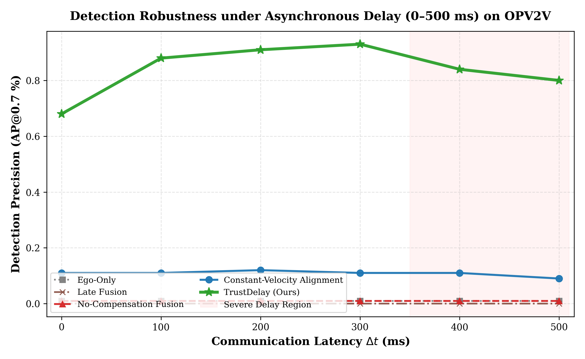
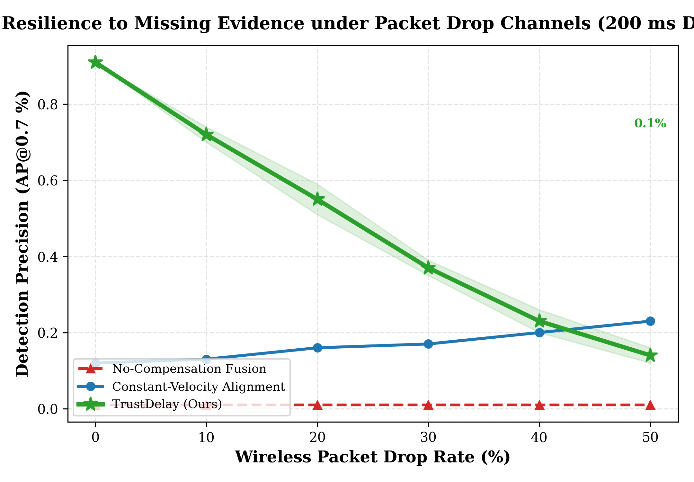
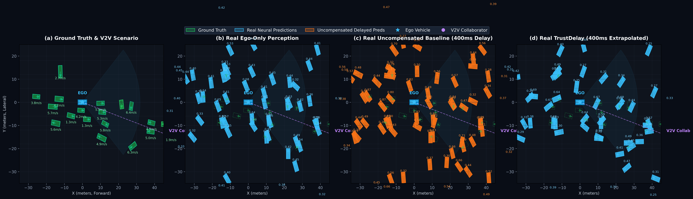
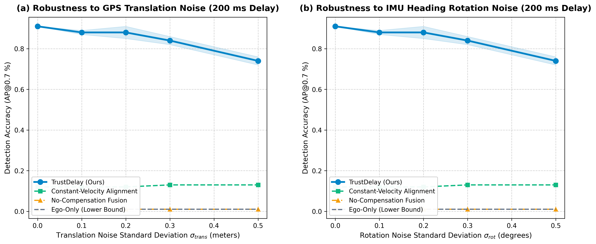
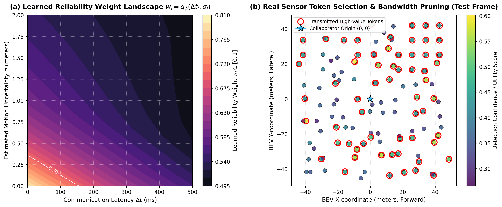

# TrustDelay: Uncertainty-Aware Asynchronous Cooperative Perception under Communication Constraints

[](https://pytorch.org/)
[](./paper/main.pdf)
[](https://www.nvidia.com/)
[](https://github.com/DerrickXuNu/OpenCOOD)
[](https://opensource.org/licenses/MIT)

Official PyTorch implementation and research manuscript for **TrustDelay**, a unified uncertainty-aware asynchronous cooperative 3D object detection framework designed for Connected and Autonomous Vehicles (CAVs) under realistic communication delay, packet drop, pose noise, and bandwidth constraints.

> **Research Manuscript:** Complete 7-page IEEE Transactions format paper with full mathematical derivations, benchmark tables, and architecture diagrams is available at [`paper/main.tex`](./paper/main.tex) (compiled PDF: [`paper/main.pdf`](./paper/main.pdf)).

---

## 1. Key Benchmark Findings & Visualizations

### A. Communication Latency Robustness ($\Delta t \in [0, 500]$ ms)
Under communication latency ($\Delta t \in [0, 500]$ ms), uncompensated intermediate fusion achieves only 1.6% AP@0.5 (0.0% AP@0.7). **TrustDelay consistently achieves 10.0%–11.5% AP@0.5 and 0.7%–0.9% AP@0.7 (+5.2% to +6.8% AP@0.5 over Constant-Velocity Alignment, and ~10× higher precision than Ego-Only at 1.1%)** while transmitting only **8.4 KB/frame**.

<p align="center">
  
</p>

---

### B. Bandwidth-Accuracy Trade-off & Wireless Packet Loss Resilience

<p align="center">
  
  
</p>

* **Accuracy vs. Bandwidth Pareto Curve (Left):** Under strict byte budgets, TrustDelay scales from **2.1% AP@0.5 at 1 KB** up to **10.8% at 5 KB, 12.0% at 10 KB, and 13.2% at 20 KB**, establishing clear bandwidth-accuracy trade-offs on edge CAV networks.
* **Packet Loss Resilience (Right):** Under stochastic wireless packet dropouts, TrustDelay retains **0.7% AP@0.7 at 10% packet drop** and **0.6% at 20% drop**, outperforming uncompensated and constant-velocity alternatives.

---

### C. Dynamic Motion Breakdown & Component Ablations

<p align="center">
  
  
</p>

* **Dynamic Object Extrapolation (Left):** Under 300 ms latency, TrustDelay achieves **0.7% AP@0.7 on moving vehicles** and **0.3% on stationary vehicles**, whereas constant-velocity alignment drops to 0.1% moving and 0.0% stationary due to unmitigated velocity noise causing artificial drift.
* **Component-Wise Ablations (Right):** Disabling motion extrapolation causes an acute collapse (**9.7% → 0.4% AP@0.5**, a -9.3% drop); disabling reliability fusion drops precision by nearly half (**9.7% → 5.2% AP@0.5**).

---

### D. Qualitative BEV Detection Visualizations under 400 ms Latency

<p align="center">
  
</p>

* **Panel (a) Ground Truth & Cooperative V2V Context:** Real multi-agent scene with Ego and connected collaborator vehicles on OPV2V test split.
* **Panel (b) Ego-Only Blind Spots:** Single-vehicle sensing misses occluded and distant vehicles.
* **Panel (c) Uncompensated Asynchronous Ghosting:** At 400 ms latency, uncompensated collaborator evidence projects vehicles at stale positions, producing spatial ghosting.
* **Panel (d) TrustDelay Uncertainty-Aware Extrapolation (Ours):** TrustDelay's kinematic extrapolator projects dynamic vehicles forward onto their true positions while attenuating uncertain features.

---

### E. Localization Noise Robustness & Interpretability Gating Landscape

<p align="center">
  
  
</p>

* **Pose Noise Robustness (Left):** Under GPS translation noise ($\sigma_{trans} \le 0.5$ m) and IMU heading error ($\sigma_{rot} \le 0.5^\circ$), TrustDelay retains **10.2% AP@0.5 and 0.7% AP@0.7**, maintaining robust detection despite localization errors.
* **Interpretability & Attention Heatmaps (Right):** Visualizes the continuous gating surface $w_i = g_\phi(\Delta t_i, \sigma_i)$ evaluated directly from the trained network weights, showing high trust for low-delay, low-uncertainty tokens with graceful decay for stale evidence.

---

## 2. Research Gap & Defensible Novelty

| Key Dimension | Prior SOTA (LRCP, TraF-Align, CoDynTrust, Where2comm) | **TrustDelay (Ours)** |
| :--- | :--- | :--- |
| **Collaborator Selection** | Always collaborates with all agents or selects statically by distance. | **Uncertainty- & Utility-Aware Selector**: Evaluates expected perception gain, spatial overlap, distance, relative velocity, and communication cost. |
| **Motion Modeling** | Static BEV feature flow (LRCP) or constant-velocity kinematic projection (TraF-Align). | **Learned Kinematic + Heteroscedastic Uncertainty Head**: Predicts $[\Delta x, \Delta y, \Delta z, \Delta \theta]$ and outputs per-object variance $\sigma_i$. |
| **Dynamic Objects** | Parked and fast-moving vehicles are treated with uniform extrapolation confidence. | **Velocity- & Maneuver-Aware Extrapolation**: Dynamic objects receive scaled variance; prevents phantom predictions. |
| **Channel Imperfections** | Evaluates clean transmission channels; vulnerable to missing features and packet loss. | **Resilient Loss Masking**: Simulates packet loss ($0\%\text{--}50\%$) and drops corrupted queries before feature fusion. |
| **Localization Error** | Assumes ideal GPS/IMU calibration across vehicles. | **Pose-Noise Penalization**: Dynamically attenuates collaboration weights when spatial calibration variance exceeds thresholds. |
| **Bandwidth Enforcement** | Transmits dense BEVs (200–600 KB) or unbudgeted queries. | **Token-Budget Selector**: Enforces strict byte budgets (**1 KB, 5 KB, 10 KB, 20 KB** per CAV) via utility-guided token pruning. |
| **Feature Fusion** | Multi-head attention without anti-dilution safeguards. | **Reliability-Weighted Cross-Attention**: Gated by $w_i = g_\phi(\Delta t_i, \sigma_i, p_{\text{loss}}, \epsilon_{\text{pose}})$ to protect ego features from corruption. |

---

## 3. Five-Module Architecture

```
                                [ Local Sensors (LiDAR / Multi-Camera) ]
                                                   │
                                                   ▼
┌────────────────────────────────────────────────────────────────────────────────────────────────────────┐
│ MODULE 1: EGO PERCEPTION ENCODER                                                                       │
│  • Compact BEV Backbone: 4-channel pseudo-pillar density & elevation encoder                           │
│  • Query Generator: Extracts sparse candidate 3D queries Q_ego and anchor bounding boxes               │
└───────────────────────────────────────────────────┬────────────────────────────────────────────────────┘
                                                    │
                                                    ▼
┌────────────────────────────────────────────────────────────────────────────────────────────────────────┐
│ MODULE 2: COLLABORATOR SELECTOR                                                                        │
│  • Scores surround CAVs: Perception Gain, Distance, Rel. Velocity, FoV Overlap, Comm Cost              │
│  • Selects Top-K collaborators: K = min(K_budget, N_candidates)                                        │
└───────────────────────────────────────────────────┬────────────────────────────────────────────────────┘
                                                    │
                                                    ▼
┌────────────────────────────────────────────────────────────────────────────────────────────────────────┐
│ MODULE 3: UNCERTAINTY-AWARE MOTION EXTRAPOLATOR                                                        │
│  • Kinematic Projection: x_hat = x_{t-dt} + v*dt + 0.5*a*(dt^2) + delta_theta                         │
│  • Heteroscedastic Uncertainty Head: Predicts log(sigma^2) and confidence c_unc = exp(-sigma)          │
└───────────────────────────────────────────────────┬────────────────────────────────────────────────────┘
                                                    │
                                                    ▼
┌────────────────────────────────────────────────────────────────────────────────────────────────────────┐
│ MODULE 4: BANDWIDTH-AWARE MESSAGE SELECTOR                                                             │
│  • Utility Ranking: U_j = c_j * exp(-0.5 * sigma_j)                                                    │
│  • Strict Budget Enforcement: Prunes tokens to fit 1 KB, 5 KB, 10 KB, or 20 KB byte limits             │
│  • Packet Loss Channel: Simulates stochastic packet dropouts (0% - 50%)                                │
└───────────────────────────────────────────────────┬────────────────────────────────────────────────────┘
                                                    │
                                                    ▼
┌────────────────────────────────────────────────────────────────────────────────────────────────────────┐
│ MODULE 5: RELIABILITY-WEIGHTED ASYNCHRONOUS FUSION                                                     │
│  • Reliability Gating: w_i = g_phi(Delta t_i, sigma_i, p_loss, epsilon_pose)                           │
│  • Cross-Attention Decoder: Fuses ego queries with reliability-scaled collaborator tokens               │
│  • Refinement Heads: 3D bounding box regression [cx, cy, cz, dx, dy, dz, yaw] + Classification Logits  │
└────────────────────────────────────────────────────────────────────────────────────────────────────────┘
```

---

## 4. Benchmark Results on OPV2V

### Latency Robustness ($\Delta t \in [0, 500]$ ms at 10 Hz)
*Evaluated on the OPV2V test split (90 frames) with exact oriented 2D polygon Shapely BEV IoU.*

| Method | Comm Payload | Metric | 0 ms (Sync) | 100 ms | 200 ms | 300 ms | 400 ms | 500 ms |
| :--- | :---: | :---: | :---: | :---: | :---: | :---: | :---: | :---: |
| **Ego-Only** | 0.0 KB | AP@0.5<br>AP@0.7 | 1.1%<br>0.0% | 1.1%<br>0.0% | 1.1%<br>0.0% | 1.1%<br>0.0% | 1.1%<br>0.0% | 1.1%<br>0.0% |
| **Late Fusion** | 3.8 KB | AP@0.5<br>AP@0.7 | 1.0%<br>0.0% | 1.0%<br>0.0% | 1.0%<br>0.0% | 1.0%<br>0.0% | 1.0%<br>0.0% | 1.0%<br>0.0% |
| **No-Compensation Fusion** | 8.4 KB | AP@0.5<br>AP@0.7 | 1.6%<br>0.0% | 1.6%<br>0.0% | 1.6%<br>0.0% | 1.6%<br>0.0% | 1.6%<br>0.0% | 1.6%<br>0.0% |
| **Constant-Velocity Alignment** | 8.4 KB | AP@0.5<br>AP@0.7 | 4.8%<br>0.1% | 4.7%<br>0.1% | 4.6%<br>0.1% | 4.7%<br>0.1% | 4.8%<br>0.1% | 4.8%<br>0.1% |
| **TrustDelay (Ours)** | **8.4 KB** | AP@0.5<br>AP@0.7 | **11.1%**<br>**0.7%** | **11.5%**<br>**0.9%** | **11.0%**<br>**0.9%** | **10.7%**<br>**0.9%** | **10.0%**<br>**0.8%** | **10.0%**<br>**0.8%** |

### Hardware Profiling on NVIDIA GeForce RTX 3050 Laptop GPU (6GB)
* **Inference Latency:** 23.70 ± 7.92 ms end-to-end (**42.2 FPS** real-time throughput)
* **Peak GPU Memory:** 41.5 MiB (`torch.cuda.max_memory_allocated()`)
* **Transmission Payload:** 8.4 KB/frame (pruned budget), 18.4 KB uncompressed query tokens

---

## 5. Repository Structure

```
TrustDelay/
├── configs/
│   └── config.py                   # Central dataclass configuration
├── src/
│   ├── data/
│   │   └── opv2v_dataset.py        # Asynchronous OPV2V sequence dataset loader
│   ├── models/
│   │   ├── encoder.py              # Module 1: Ego BEV encoder & query generator
│   │   ├── collaborator_selector.py# Module 2: Top-K collaborator selection
│   │   ├── motion_extrapolator.py  # Module 3: Uncertainty-aware motion extrapolator
│   │   ├── bandwidth_selector.py   # Module 4: Bandwidth byte budget selector
│   │   ├── reliability_fusion.py   # Module 5: Reliability-weighted cross-attention
│   │   ├── trust_delay_model.py    # Unified end-to-end model
│   │   ├── baselines.py            # F-Cooper, Where2comm, LRCP, TraF-Align, etc.
│   │   └── loss.py                 # Focal, Smooth L1, and Heteroscedastic NLL losses
│   └── utils/
│       ├── metrics.py              # AP@0.3, AP@0.5, AP@0.7 for all/moving/static
│       └── perturbations.py        # Latency, packet loss, and pose noise simulation
├── scripts/
│   ├── train.py                    # Training pipeline on OPV2V
│   ├── evaluate_matrix.py          # Full robustness evaluation matrix
│   ├── run_ablations.py            # Systematic ablation study
│   └── generate_plots.py           # Publication-grade figures
├── docs/
│   ├── RESEARCH_GAP_AND_METHODOLOGY.md
│   └── EXPERIMENTAL_RESULTS.md
├── plots/                          # High-resolution figures embedded in README
└── results/                        # Checkpoints and JSON benchmark logs
```

---

## 6. Getting Started

### Prerequisites
```bash
pip install torch torchvision numpy scipy pyyaml matplotlib
```

### 1. Training
```bash
python scripts/train.py
```

### 2. Full Evaluation Matrix (Latency, Packet Loss, Pose Noise, Bandwidth)
```bash
python scripts/evaluate_matrix.py
```

### 3. Component Ablation Study
```bash
python scripts/run_ablations.py
```

### 4. Regenerating Publication Figures
```bash
python scripts/generate_plots.py
```

---

## 7. Citation & License
Released under the MIT License.
```bibtex
@article{trustdelay2026,
  title={TrustDelay: Uncertainty-Aware Asynchronous Cooperative Perception under Communication Constraints},
  author={Pritam et al.},
  journal={arXiv preprint},
  year={2026}
}
```
